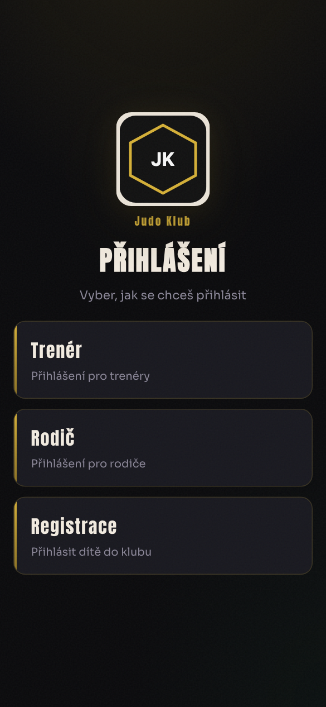
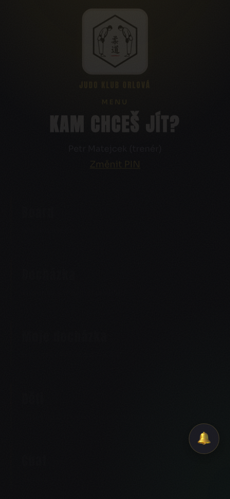
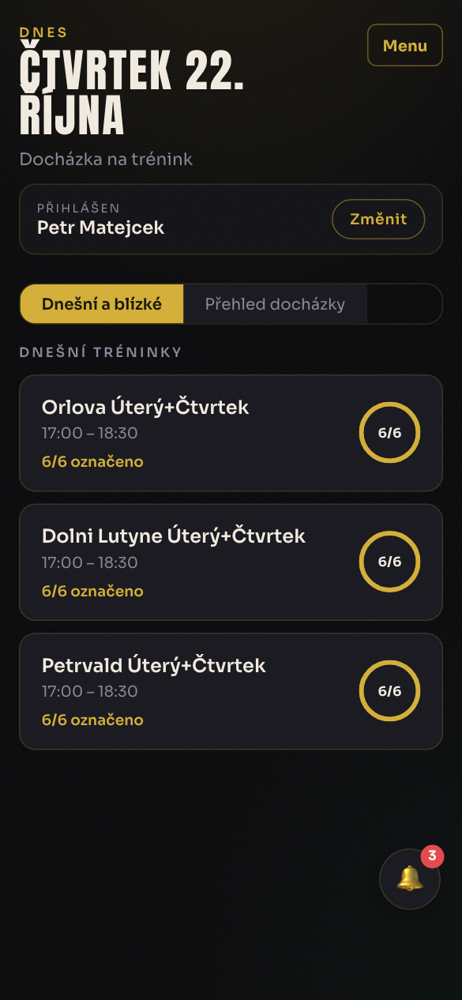
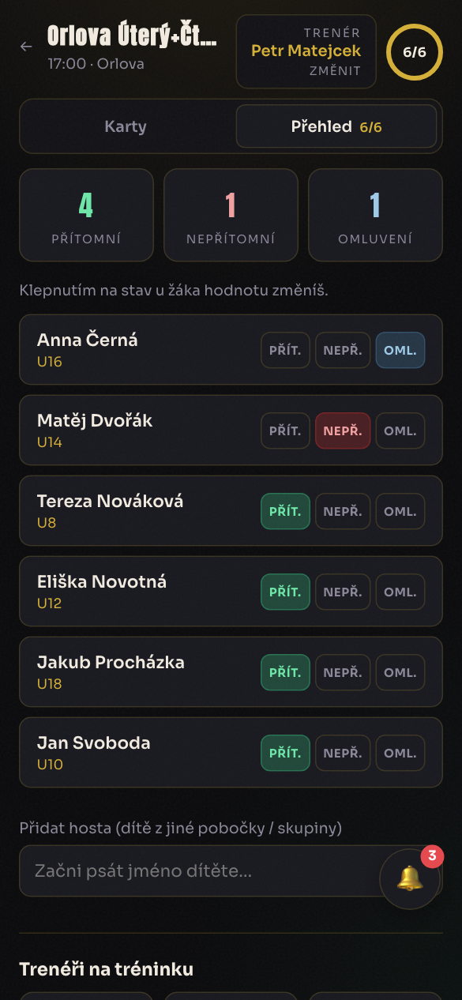
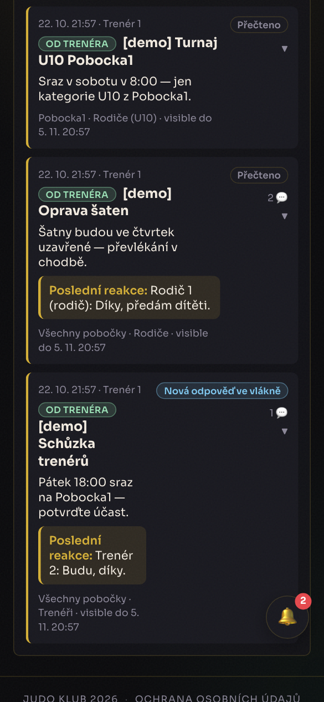
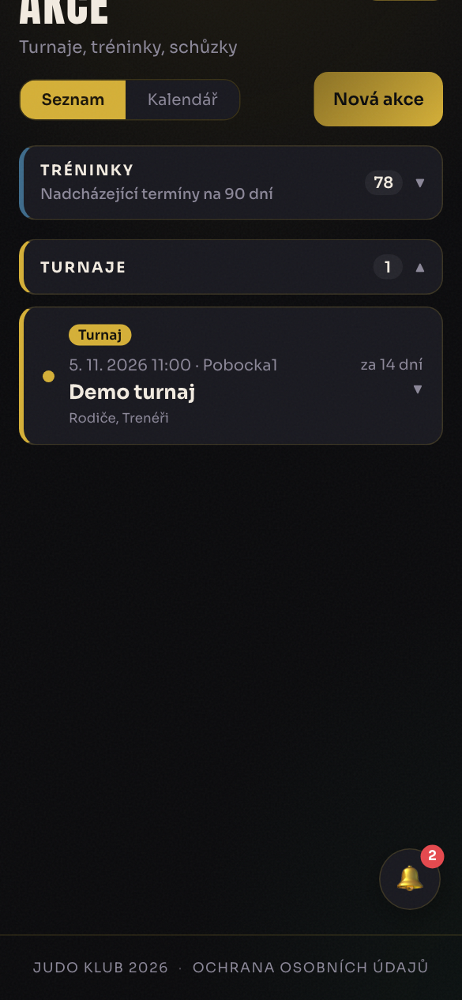
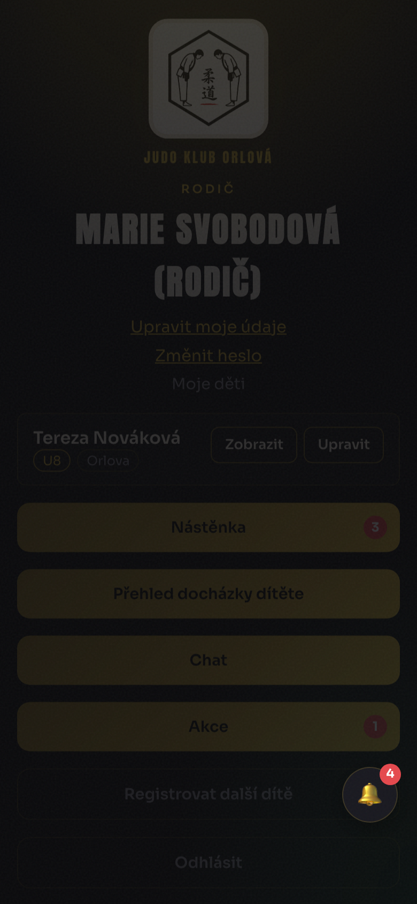
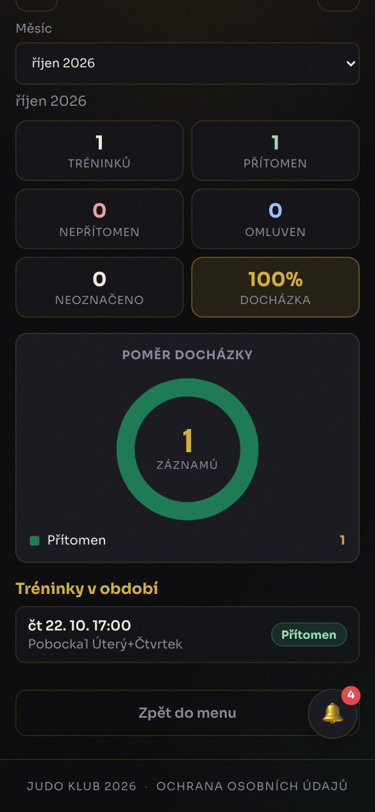
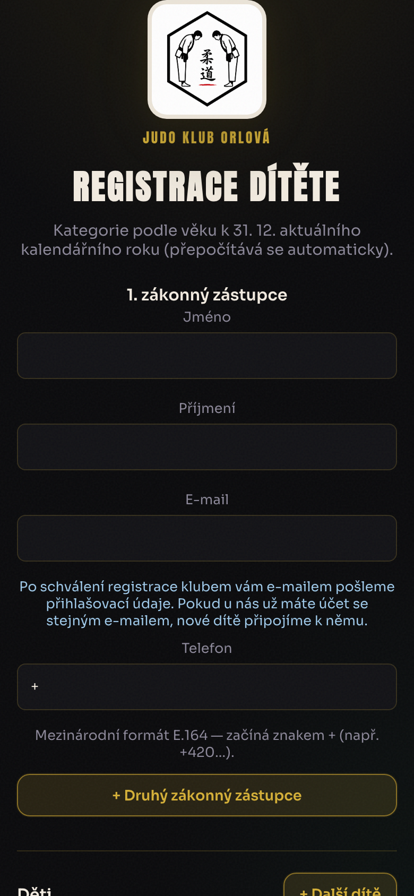
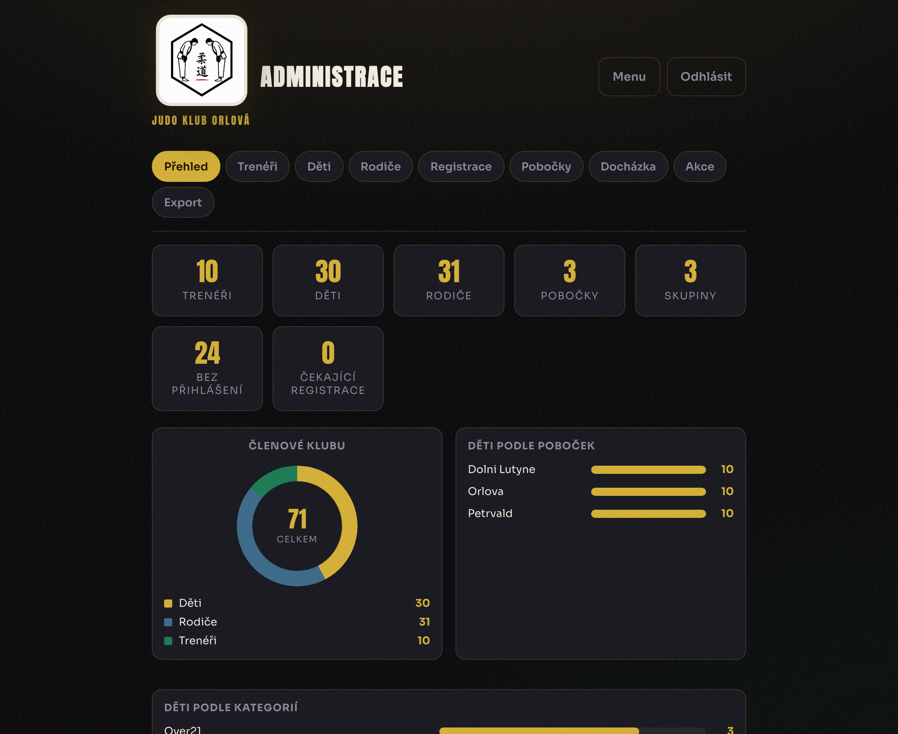

# Judo Platform

Mobilní webová platforma pro **judo klub** — trenéři, rodiče i administrativa na jednom místě.

Docházka na tatami, nástěnka, chat, akce/turnaje, registrace dětí a správa poboček. Postaveno jako FastAPI + React (Vite), s demo daty pro lokální vyzkoušení.

<p align="center">
  
</p>

## Pro koho je to

| Role | Co umí |
|------|--------|
| **Trenér** | Docházka (swipe / seznam), nástěnka, chat, akce, děti na pobočce, reporty k proplacení |
| **Rodič** | Přehled docházky dítěte, nástěnka, chat, RSVP na akce, správa údajů |
| **Admin** | Trenéři, děti, rodiče, pobočky, registrace, exporty a statistiky |
| **Nový zájemce** | Veřejná registrace dítěte ke schválení klubem |

## Náhledy (demo data)

### Trenér — menu a docházka

<p align="center">
  
  &nbsp;
  
  &nbsp;
  
</p>

### Nástěnka a akce

<p align="center">
  
  &nbsp;
  
</p>

### Rodič a registrace

<p align="center">
  
  &nbsp;
  
  &nbsp;
  
</p>

### Administrace

<p align="center">
  
</p>

## Hlavní funkce

- **Docházka** — rychlé označení přítomný / nepřítomný / omluven, hosté z jiné pobočky, měsíční přehledy
- **Nástěnka** — oznámení mezi trenéry a rodiči s odpověďmi
- **Akce** — turnaje, schůzky, tréninky; RSVP a veřejné share odkazy (QR / WhatsApp)
- **Chat** — 1:1 zprávy
- **Registrace** — žádost o přijetí dítěte + souhlas s ochranou osobních údajů
- **Více poboček** — např. Pobocka1, Pobocka2, Pobocka3
- **Kategorie** — U8–U18, U21, Over 21

## Rychlý start

```bash
# Backend
source .venv/bin/activate          # Windows: .venv\Scripts\activate
pip install -r requirements.txt
uvicorn app.main:app --reload --port 8001

# Frontend (druhý terminál)
cd frontend
cp .env.example .env               # volitelně VITE_API_URL
npm install
npm run dev
```

### Demo data

```bash
python scripts/reset_and_seed_demo.py   # 30 dětí, trenéři, dnešní docházka, notifikace, chat
```

Výchozí demo přihlášení po seedu (viz `scripts/demo_state.json`):

| Role | Přihlášení |
|------|------------|
| Trenér | Trenér 1 … 6 + PIN `123456` |
| Rodič | `rodic1` / `demo1234` |
| Admin | `admin` / `admin` |

Screenshoty pro README:

```bash
TRAINER_PIN=123456 python scripts/capture_readme_screenshots.py
```

## Dokumentace

| Dokument | Obsah |
|----------|--------|
| [docs/API.md](docs/API.md) | Endpointy, auth, schémata |
| [docs/DEPLOY_RENDER.md](docs/DEPLOY_RENDER.md) | Nasazení na Render.com |
| [docs/DEPLOY_ORACLE.md](docs/DEPLOY_ORACLE.md) | Nasazení na Oracle Cloud VPS |

## Stack

- **Backend:** FastAPI, SQLAlchemy 2, async SQLite (`aiosqlite`)
- **Frontend:** React + Vite + TanStack Query
- **Auth:** JWT (trenér PIN, rodič username/heslo, admin)

---

*Demo judo platforma — pouze anonymní testovací data.*
